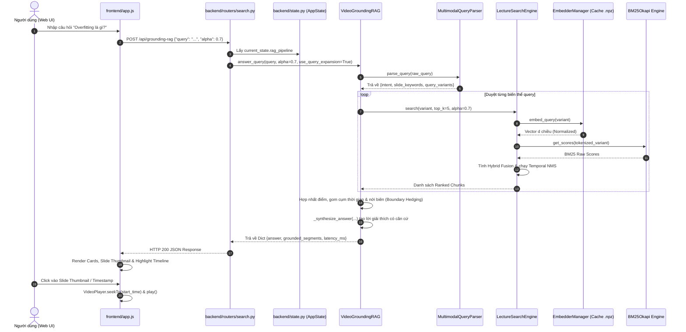

# 📚 TÀI LIỆU KỸ THUẬT TOÀN DIỆN HỆ THỐNG LECLENS
> **Multimodal Temporal Video Grounding & Lecture Search Assistant**  
> *Phiên bản: 2.0.0 | Tài liệu kỹ thuật chi tiết dành cho Kỹ sư Hệ thống, Developer & QA*

---

## 1. TỔNG QUAN KIẾN TRÚC & LUỒNG HOẠT ĐỘNG CHÍNH (END-TO-END WORKFLOW)

### 1.1 Mục tiêu và nghiệp vụ chính của hệ thống
**LecLens** là hệ thống trợ lý học tập đa phương thức (Multimodal Temporal Video Grounding RAG), cho phép người học tìm kiếm, định vị chính xác phân đoạn video bài giảng (tính theo giây) và giải đáp thắc mắc bằng ngôn ngữ tự nhiên. 
Hệ thống giải quyết bài toán cốt lõi: **Không cần xem hết video 60–90 phút để tìm một khái niệm**, mà có thể hỏi trực tiếp câu hỏi (ví dụ: *"Khi nào thì xảy ra Overfitting và cách khắc phục?"*), hệ thống sẽ:
1. Đồng bộ hóa cả **nhánh Âm thanh (Audio Speech Transcription)** và **nhánh Thị giác (Slide Keyframe & OCR)**.
2. Tìm kiếm lai (Hybrid Search: Sparse BM25 + Dense Semantic Embeddings).
3. Gom cụm thời gian (Temporal Segment Grouping) và định vị ranh giới thời gian (Boundary Hedging).
4. Tạo câu trả lời tổng hợp kèm bằng chứng mốc thời gian (Timestamped Evidence) và hình ảnh slide tương ứng để người dùng bấm vào là video tự động tua tới đúng phân đoạn đó.
5. Hệ thống được thiết kế tối ưu hóa chuyên biệt cho phần cứng CPU thông thường (Intel Core i5, 12GB RAM, ONNX Runtime) và hỗ trợ tăng tốc qua Groq Cloud LPU.

### 1.2 Entry Point (Điểm bắt đầu thực thi)
Hệ thống có hai điểm vào chính tùy thuộc vào môi trường vận hành:
1. **CLI / Local Runner Entry Point:** `execute.py`  
   - Tự động dò tìm cổng mạng khả dụng (`find_available_port`, mặc định từ `8000`).
   - Tự động mở trình duyệt Web UI mặc định (`webbrowser.open(url)`).
   - Khởi chạy Uvicorn ASGI Server chạy ứng dụng FastAPI `backend.main:app`.
2. **ASGI Server Entry Point:** `backend/main.py` (`app = FastAPI(...)`)
   - Khởi tạo tiến trình, nạp cấu hình `backend.config`.
   - Đăng ký middleware (CORS).
   - Đăng ký các router chức năng: `media_router`, `search_router`, `system_router`.
   - Mount các static mount endpoints: `/keyframes`, `/uploads`, `/static`, `/`.
   - Kích hoạt sự kiện khởi động `@app.on_event("startup")` (`startup_event`), tự động nạp bài giảng mẫu mặc định vào bộ nhớ chia sẻ `backend.state.current_state`.

---

### 1.3 Luồng hoạt động chi tiết từng bước (Step-by-step Execution Lifecycle)

#### Bước 1: Tiếp nhận dữ liệu đầu vào / Khởi tạo môi trường
- Người dùng truy cập Web UI (`frontend/index.html` + `frontend/app.js`).
- Khi khởi động, backend kích hoạt `startup_event()`: Nạp file phụ đề mẫu (`data/samples/deep_learning_fundamentals_en.srt`) vào bộ nhớ `current_state`.
- Người dùng có 3 cách nạp bài giảng mới:
  1. **Chọn bài giảng mẫu:** Gửi POST tới `/api/load-sample` với `sample_key`.
  2. **Dán link YouTube:** Gửi POST tới `/api/load-youtube` với `url` hoặc `video_id`.
  3. **Tải tệp Video MP4 / SRT:** Gửi POST multipart tới `/api/upload` với `video_file` và/hoặc `subtitle_file`.

#### Bước 2: Tiền xử lý, validation và phân luồng nghiệp vụ
- **Xác thực yêu cầu:** Pydantic Schemas (`backend/schemas.py`) kiểm tra kiểu dữ liệu của payload (`SearchRequest`, `RagQueryRequest`, `LoadSampleRequest`, `YouTubeLoadRequest`).
- **Phân luồng xử lý âm thanh:**
  - Nếu đã có file `.srt`/`.vtt`: Hàm `parse_srt_or_vtt` đọc file, chuẩn hóa khoảng trắng và chuyển đổi timestamp thành giây (`timestamp_to_seconds`).
  - Nếu là link YouTube: `fetch_youtube_transcript` gọi `YouTubeTranscriptApi` trích xuất phụ đề tự động hoặc phụ đề thủ công.
  - Nếu là video chưa có phụ đề: `transcribe_with_groq` (ưu tiên) hoặc `transcribe_local_video` (fallback) tách audio, nén MP3 và gọi Whisper ASR để sinh mốc thời gian.
- **Phân luồng xử lý thị giác (Video Slide Keyframes):**
  - Nếu có file video: `VisionExtractor.extract_slide_keyframes()` chạy dò điểm chuyển cảnh qua PyAV (`sample_interval_sec=25.0`, `diff_threshold=0.1`).
  - Lưu ảnh slide JPEG vào `data/keyframes/{video_id}/`.
  - Gọi RapidOCR trên ONNX Runtime bóc tách văn bản thô.
  - `VietnameseTextEnhancer` đối chiếu ngữ cảnh phụ đề để sửa lỗi chính tả OCR, lọc bỏ watermark, tách `slide_title` và `ocr_keywords`.

#### Bước 3: Tính toán cốt lõi, gọi các service / module phụ thuộc
- **Phân mảnh cửa sổ trượt (Sliding Window Chunking):**  
  `create_temporal_chunks` trong `backend/audio/chunker.py` chia chuỗi phụ đề thành các cửa sổ `window_seconds=30s` (hoặc 45s) với bước trượt `stride_seconds=15s` (hoặc 20s).
- **Làm giàu đa phương thức (Multimodal Fusion):**  
  `enrich_chunks_with_multimodal_metadata` gán slide keyframe và từ khóa OCR đang hiển thị vào từng chunk âm thanh, tạo trường ngữ nghĩa tích hợp `semantic_metadata_text`.
- **Lập chỉ mục tìm kiếm (Indexing):**  
  `initialize_engine` khởi tạo đối tượng `LectureSearchEngine`:
  - Khởi tạo BM25 Okapi từ tokenized text của toàn bộ corpus.
  - Gọi `EmbedderManager.embed_chunks` nhúng toàn bộ chunk thành ma trận vector $N \times D$.
- **Xử lý truy vấn (Query & Grounding Pipeline):**  
  Khi người dùng tìm kiếm (`/api/search`) hoặc hỏi đáp (`/api/grounding-rag`):
  1. `MultimodalQueryParser` phân tích ý định, bóc tách từ khóa slide/audio, sinh biến thể câu hỏi (Query Expansion).
  2. `LectureSearchEngine.search()` tính điểm lai:  
     $$\text{Hybrid Score} = \alpha \cdot \text{Dense Cosine Sim} + (1 - \alpha) \cdot \text{BM25 Score}$$
  3. `_temporal_nms` (Temporal Non-Maximum Suppression) lọc bỏ các phân đoạn chồng lấn thời gian (IoU > 0.6) để kết quả Top-K đa dạng.
  4. `VideoGroundingRAG.answer_query` gom cụm các mốc thời gian gần nhau, nới rộng biên an toàn 4s (`Boundary Hedging`) và sinh câu trả lời có căn cứ (`_synthesize_answer`).

#### Bước 4: Tương tác tầng dữ liệu (Database / Cache / File / API bên ngoài)
- **Tầng Cache Embedding:** `backend/core/embedder.py` tính mã băm SHA-256 từ nội dung văn bản và model key; lưu/đọc ma trận vector trực tiếp từ tệp nén `.npz` tại `data/cache/`, tránh tính toán lại.
- **Tầng Cache Keyframe & OCR:** Lưu metadata slide vĩnh viễn trong file JSON tại `data/keyframes/{video_id}/keyframe_metadata.json`. Lần truy vấn sau phản hồi < **10ms**.
- **Tầng File Upload:** Lưu video và srt tải lên tại `data/uploads/`.
- **Tầng Annotation / Benchmark:** `AnnotationManager` lưu trữ nhãn đánh giá của người dùng tại `data/annotations/user_annotations.json`.

#### Bước 5: Đóng gói và trả về kết quả / Ghi log / Xử lý hậu kỳ
- Router đóng gói kết quả dạng chuẩn RESTful JSON: mốc thời gian bắt đầu/kết thúc (`start_time`, `end_time`), định dạng chuỗi (`start_str`, `end_str`), điểm tương đồng (`score`), văn bản trích dẫn (`text`), tiêu đề slide (`slide_title`), đường dẫn ảnh slide (`keyframe_url`), câu trả lời tổng hợp (`answer`).
- Ghi log thời gian thực thi (latency ms) qua `get_logger()`.
- Client (`frontend/app.js`) nhận JSON, hiển thị giao diện thẻ kết quả, highlight timeline và kích hoạt tính năng click-to-seek trên video player.

---

### 1.4 Sơ đồ Tương Tác Chi Tiết (Mermaid Sequence Diagram)



---

## 2. LUỒNG DỮ LIỆU & QUẢN LÝ TRẠNG THÁI (DATA PIPELINE & STATE LIFECYCLE)

### 2.1 Cấu trúc dữ liệu chính di chuyển qua các tầng (Data Contracts, Schemas & DTO)

#### 1. DTO Phụ đề Thô (`SubtitleCue` - `dict`):
```json
{
  "index": 1,
  "start": 12.5,
  "end": 18.2,
  "start_str": "00:12",
  "end_str": "00:18",
  "text": "Khái niệm đầu tiên chúng ta học là Overfitting."
}
```

#### 2. DTO Phân đoạn Cửa sổ trượt Đa phương thức (`EnrichedChunk` - `dict`):
```json
{
  "chunk_id": "chunk_004",
  "start_time": 45.0,
  "end_time": 90.0,
  "start_str": "00:45",
  "end_str": "01:30",
  "text": "Lời giảng ghép từ các subtitle cues trong 45 giây...",
  "slide_title": "Hiện Tượng Quá Khớp (Overfitting)",
  "ocr_keywords": "Overfitting, High Variance, Train vs Test Error",
  "keyframe_url": "/keyframes/cs229_lec01/slide_003.jpg",
  "semantic_metadata_text": "Hiện Tượng Quá Khớp... Overfitting, High Variance... Lời giảng ghép..."
}
```

#### 3. DTO Trạng thái Hệ thống Toàn cục (`AppState` - `backend/state.py`):
```python
class AppState:
    active_subtitles: List[Dict]           # Toàn bộ câu phụ đề thô
    active_chunks: List[Dict]              # Danh sách enriched temporal chunks
    search_engine: LectureSearchEngine     # Thể hiện của BM25 + SBERT Index
    rag_pipeline: VideoGroundingRAG        # Thể hiện của RAG Reasoning Engine
    active_video_id: str                   # ID của bài giảng (ví dụ "custom_1791461236")
    active_video_title: str                # Tiêu đề bài giảng hiển thị
    active_video_path: Optional[str]       # Đường dẫn file video cục bộ phục vụ stream
    active_keyframes: List[Dict]           # Danh sách slide keyframes & OCR
    model_key: str                         # Tên embedding model (mặc định "vietnamese-sbert")
    window_seconds: float                  # Kích thước sliding window (30s - 45s)
    stride_seconds: float                  # Bước nhảy sliding window (15s - 20s)
```

---

### 2.2 Trạng thái dữ liệu biến đổi qua từng giai đoạn
1. **Raw Video/Audio File** $\rightarrow$ **Whisper Raw Segments** (chuỗi audio array giải mã thành văn bản mốc thời gian).
2. **Raw Segments** $\rightarrow$ **Filtered Subtitle Cues** (chuẩn hóa Unicode, loại bỏ thẻ WebVTT/HTML).
3. **Cues** $\rightarrow$ **Sliding Temporal Windows** (gom nhóm có độ gối đầu).
4. **Temporal Windows + Keyframe OCR** $\rightarrow$ **Unified Multimodal Chunks** (kết hợp thị giác và thính giác).
5. **Multimodal Chunks** $\rightarrow$ **Tokenized Corpus (BM25) & Dense Vector Matrix $(N \times D)$** (lưu đĩa dạng `.npz`).
6. **User Query String** $\rightarrow$ **Query Representations (Parsed Intent + Keywords + Query Vector)**.
7. **Similarity Scores** $\rightarrow$ **Non-Maximum Suppressed Segments** $\rightarrow$ **Grounded Evidence Package**.

---

### 2.3 Luồng xử lý lỗi và cơ chế Fallback (Error Handling & Recovery Flow)
- **ASR Fallback:** Nếu gọi Groq Cloud LPU Whisper thất bại (sai API key, hết quota, hoặc mất mạng), hệ thống ghi log cảnh báo và tự động fallback sang `faster-whisper` chạy cục bộ trên CPU.
- **OCR Enhancer Fallback:** Nếu thuật toán so khớp n-gram phụ đề không tìm thấy tiêu đề phù hợp, hệ thống fallback về việc lấy dòng chữ đầu tiên có độ dài hợp lệ (> 4 ký tự) và không chứa từ khóa watermark.
- **RAG Expansion Fallback:** Nếu truy vấn qua biến thể mở rộng không trả về kết quả nào đạt ngưỡng tương đồng tối thiểu (> 0.05), hệ thống fallback sang câu truy vấn gốc `raw_query` và giảm nhẹ ràng buộc NMS.
- **Video Stream Fallback (HTTP 206 Partial Content):** Khi xem video MP4 lớn, `stream_video` hỗ trợ chuẩn HTTP 206 Byte-Range. Nếu client không gửi header `Range`, router trả về toàn bộ file an toàn.
- **Embedding Disk Cache Recovery:** Nếu file `.npz` bị hỏng hoặc không tương thích kích thước ma trận, khối `try...except` trong `EmbedderManager` sẽ tự động xóa cache lỗi và nhúng lại từ đầu.

---

## 3. TỪ ĐIỂN CÔNG DỤNG TỪNG HÀM (FUNCTION-BY-FUNCTION REFERENCE)

---

### File: `execute.py`
- **Mục đích:** CLI Entry point khởi động ứng dụng, tự động cấp phát cổng mạng khả dụng và mở trình duyệt web.

| Tên hàm / Method | Tham số (Params & Types) | Giá trị trả về (Returns) | Công dụng chi tiết & Logic xử lý | Hàm/Module phụ thuộc | Ngoại lệ có thể xảy ra |
| :--- | :--- | :--- | :--- | :--- | :--- |
| `is_port_in_use()` | `port: int` | `bool` | Kiểm tra xem cổng TCP cục bộ `127.0.0.1:port` có đang bị tiến trình khác chiếm dụng hay không bằng `socket.connect_ex`. | `socket.socket` | `OSError` |
| `find_available_port()` | `start_port: int = 8000` | `int` | Lặp tăng dần cổng bắt đầu từ `8000` cho đến khi tìm thấy cổng trống chưa bị sử dụng. | `is_port_in_use()` | Không có |

---

### File: `backend/config.py`
- **Mục đích:** Định nghĩa các hằng số cấu hình, đường dẫn thư mục lưu trữ (`data/`, `keyframes/`, `cache/`), tham số mặc định và bộ ghi log chuẩn hóa.

| Tên hàm / Method | Tham số (Params & Types) | Giá trị trả về (Returns) | Công dụng chi tiết & Logic xử lý | Hàm/Module phụ thuộc | Ngoại lệ có thể xảy ra |
| :--- | :--- | :--- | :--- | :--- | :--- |
| `get_logger()` | `name: str` | `logging.Logger` | Khởi tạo và trả về đối tượng Logger với định dạng chuẩn `[timestamp][name][level] message`, gắn StreamHandler xuất ra terminal. | `logging.getLogger`, `logging.StreamHandler` | Không có |

---

### File: `backend/state.py`
- **Mục đích:** Quản lý trạng thái phiên làm việc trong bộ nhớ RAM (`AppState`), lưu giữ thông tin bài giảng đang nạp, engine tìm kiếm và pipeline RAG.

| Tên hàm / Method | Tham số (Params & Types) | Giá trị trả về (Returns) | Công dụng chi tiết & Logic xử lý | Hàm/Module phụ thuộc | Ngoại lệ có thể xảy ra |
| :--- | :--- | :--- | :--- | :--- | :--- |
| `initialize_engine()` | `subtitles: List[Dict], window: float, stride: float, model_key: str, video_id: str, title: str, video_path: Optional[str] = None` | `List[Dict]` | Cập nhật đối tượng `current_state`: cắt chunks bằng `create_temporal_chunks`, làm giàu metadata đa phương thức, khởi tạo `LectureSearchEngine` và `VideoGroundingRAG`. Trả về danh sách chunks đã xử lý. | `create_temporal_chunks`, `enrich_chunks_with_multimodal_metadata`, `LectureSearchEngine`, `VideoGroundingRAG` | `RuntimeError`, `ValueError` |

---

### File: `backend/schemas.py`
- **Mục đích:** Định nghĩa các Pydantic DTO data contract cho request payload của toàn bộ các API endpoint.

| Tên Class / Schema | Các trường dữ liệu (Fields & Types) | Công dụng & Phạm vi sử dụng |
| :--- | :--- | :--- |
| `SearchRequest` | `query: str`, `top_k: int = 3`, `alpha: float = 0.7`, `model_key: Optional[str]` | Xác thực payload tìm kiếm video bài giảng thông thường qua `/api/search`. |
| `RagQueryRequest` | `query: str`, `alpha: float = 0.7`, `use_query_expansion: bool = True` | Xác thực payload câu hỏi tự nhiên cho Video Grounding RAG qua `/api/grounding-rag`. |
| `LoadSampleRequest` | `sample_key: str` | Xác thực yêu cầu nạp bài giảng mẫu qua `/api/load-sample`. |
| `YouTubeLoadRequest` | `url: str`, `title: Optional[str]`, `window_size: float = 30.0`, `stride_size: float = 15.0` | Xác thực URL YouTube cần cào phụ đề và lập chỉ mục qua `/api/load-youtube`. |
| `GroqKeyRequest` | `api_key: str` | Xác thực chuỗi API key Groq khi người dùng cập nhật qua `/api/groq-config`. |
| `AnnotationRequest` | `video_id: str`, `query: str`, `start: float`, `end: float`, `rating: str`, `notes: str = ""`, `predicted_start: Optional[float]`, `predicted_end: Optional[float]` | Xác thực payload đánh giá chất lượng mốc thời gian của người dùng qua `/api/annotate`. |

---

### File: `backend/main.py`
- **Mục đích:** Khởi tạo ứng dụng FastAPI, đăng ký middleware CORS, liên kết các router con và phục vụ trang Single-Page Application (SPA).

| Tên hàm / Method | Tham số (Params & Types) | Giá trị trả về (Returns) | Công dụng chi tiết & Logic xử lý | Hàm/Module phụ thuộc | Ngoại lệ có thể xảy ra |
| :--- | :--- | :--- | :--- | :--- | :--- |
| `startup_event()` | Không có | `None` | Callback chạy khi server khởi động: kiểm tra file phụ đề mẫu mặc định và tự động gọi `initialize_engine` để hệ thống sẵn sàng ngay lập tức. | `parse_srt_or_vtt`, `initialize_engine` | `Exception` |
| `serve_favicon()` | Không có | `FileResponse` | Phục vụ tệp icon trình duyệt `favicon.ico` từ thư mục frontend. | `FileResponse` | `FileNotFoundError` |
| `serve_index()` | Không có | `FileResponse` | Phục vụ file giao diện chính `frontend/index.html` cho đường dẫn root `/`. | `FileResponse` | `FileNotFoundError` |

---

### File: `backend/audio/subtitle_parser.py`
- **Mục đích:** Bóc tách, làm sạch và chuyển đổi định dạng các tệp phụ đề SRT / WebVTT thành danh sách các cấu trúc dữ liệu chuẩn.

| Tên hàm / Method | Tham số (Params & Types) | Giá trị trả về (Returns) | Công dụng chi tiết & Logic xử lý | Hàm/Module phụ thuộc | Ngoại lệ có thể xảy ra |
| :--- | :--- | :--- | :--- | :--- | :--- |
| `timestamp_to_seconds()` | `ts_str: str` | `float` | Chuyển đổi chuỗi mốc thời gian (`HH:MM:SS,mmm` hoặc `MM:SS.mmm`) sang giá trị giây dạng số thực (`float`). | `re.split` | `ValueError` |
| `seconds_to_timestamp()` | `seconds: float, format_style: str = "compact"` | `str` | Chuyển đổi số giây thành chuỗi thời gian định dạng dễ đọc (`MM:SS` hoặc `HH:MM:SS`). | Không có | Không có |
| `clean_subtitle_text()` | `text: str` | `str` | Xóa sạch các thẻ HTML formatting (`<i>`, `<b>`, `<font>`), thẻ WebVTT (`<c.color>`), và chuẩn hóa khoảng trắng thừa. | `re.sub` | Không có |
| `parse_srt_or_vtt()` | `content_or_path: Union[str, Path]` | `List[Dict]` | Đọc nội dung file SRT/VTT (tự động nhận diện encoding UTF-8 / UTF-8-sig / Latin-1), dùng Regex bóc tách từng cue (index, start, end, text). | `timestamp_to_seconds`, `clean_subtitle_text` | `FileNotFoundError`, `ValueError` |

---

### File: `backend/audio/chunker.py`
- **Mục đích:** Gom nhóm các câu phụ đề ngắn thành các phân đoạn thời gian liên tục theo cơ chế cửa sổ trượt (Sliding Window).

| Tên hàm / Method | Tham số (Params & Types) | Giá trị trả về (Returns) | Công dụng chi tiết & Logic xử lý | Hàm/Module phụ thuộc | Ngoại lệ có thể xảy ra |
| :--- | :--- | :--- | :--- | :--- | :--- |
| `create_temporal_chunks()` | `subtitles: List[Dict], window_seconds: float = 30.0, stride_seconds: float = 15.0` | `List[Dict]` | Duyệt mốc thời gian từ đầu đến cuối video; tại mỗi bước `stride_seconds`, lấy tất cả các câu phụ đề nằm trong khoảng `[w_start, w_start + window_seconds]`, ghép lại thành một chunk hoàn chỉnh kèm timestamp bắt đầu/kết thúc. | `seconds_to_timestamp` | Không có |

---

### File: `backend/audio/groq_transcriber.py`
- **Mục đích:** Tích hợp API Groq Cloud LPU chạy mô hình `whisper-large-v3` để nhận dạng giọng nói video với tốc độ siêu nhanh (~300x realtime).

| Tên hàm / Method | Tham số (Params & Types) | Giá trị trả về (Returns) | Công dụng chi tiết & Logic xử lý | Hàm/Module phụ thuộc | Ngoại lệ có thể xảy ra |
| :--- | :--- | :--- | :--- | :--- | :--- |
| `get_saved_groq_key()` | Không có | `Optional[str]` | Đọc API key Groq từ biến môi trường `GROQ_API_KEY` hoặc từ file cấu hình bảo mật `data/groq_config.json`. | `json.load` | Không có |
| `save_groq_key()` | `api_key: str` | `None` | Lưu API key của người dùng vào tệp `data/groq_config.json`. | `json.dump` | `IOError` |
| `encode_numpy_to_mp3()` | `audio_arr: np.ndarray, output_path: str, sr: int = 16000, bit_rate: int = 32000` | `None` | Sử dụng PyAV (`av`) mã hóa mảng numpy audio 16kHz float32 thành file MP3 dung lượng siêu nhẹ (bitrate 32kbps) để gửi qua mạng nhanh nhất. | `av.open` | `Exception` |
| `transcribe_with_groq()` | `video_path: str, api_key: Optional[str] = None, model: str = "whisper-large-v3", language: Optional[str] = None` | `List[Dict]` | Trích xuất âm thanh từ video, nén MP3, gọi API `groq.audio.transcriptions.create` với prompt cưỡng bức tiếng Việt có dấu. Trả về danh sách phụ đề chi tiết. | `encode_numpy_to_mp3`, `Groq.audio.transcriptions.create`, `seconds_to_timestamp` | `RuntimeError`, `AuthenticationError` |

---

### File: `backend/audio/audio_transcriber.py`
- **Mục đích:** Quản lý việc trích xuất phụ đề từ YouTube hoặc chạy nhận dạng giọng nói ngoại tuyến bằng `faster-whisper`.

| Tên hàm / Method | Tham số (Params & Types) | Giá trị trả về (Returns) | Công dụng chi tiết & Logic xử lý | Hàm/Module phụ thuộc | Ngoại lệ có thể xảy ra |
| :--- | :--- | :--- | :--- | :--- | :--- |
| `extract_youtube_video_id()` | `url_or_id: str` | `Optional[str]` | Sử dụng biểu thức chính quy (Regex) để bóc tách 11 ký tự Video ID từ các định dạng URL YouTube khác nhau (`youtu.be`, `watch?v=`, `embed/`). | `re.search` | Không có |
| `fetch_youtube_transcript()` | `url_or_id: str` | `List[Dict]` | Sử dụng `youtube_transcript_api` để tải phụ đề chính thức hoặc phụ đề tự động (ưu tiên tiếng Việt 'vi', sau đó 'en'). | `YouTubeTranscriptApi.get_transcript` | `RuntimeError` |
| `transcribe_local_video()` | `video_path: str, model_size: str = "tiny", language: Optional[str] = None` | `List[Dict]` | Chạy mô hình Faster-Whisper cục bộ trên CPU máy chủ khi không có kết nối internet hoặc không có Groq API key. | `faster_whisper.WhisperModel` | `RuntimeError` |

---

### File: `backend/vision/vietnamese_text_enhancer.py`
- **Mục đích:** Sửa lỗi chính tả tiếng Việt cho OCR, phục hồi dấu thanh từ phụ đề âm thanh và lọc bỏ watermark không liên quan trên slide.

| Tên hàm / Method | Tham số (Params & Types) | Giá trị trả về (Returns) | Công dụng chi tiết & Logic xử lý | Hàm/Module phụ thuộc | Ngoại lệ có thể xảy ra |
| :--- | :--- | :--- | :--- | :--- | :--- |
| `remove_accents()` | `s: str` | `str` | Bỏ toàn bộ dấu tiếng Việt (chuyển chữ có dấu thành không dấu) phục vụ việc mapping tra cứu không phân biệt dấu. | `unicodedata.normalize` | Không có |
| `VietnameseTextEnhancer.__init__()` | `srt_path: str = None` | `None` | Khởi tạo từ điển n-gram và danh sách từ vựng chuẩn từ file phụ đề làm Ground Truth đối chiếu. | `parse_srt_or_vtt` | Không có |
| `extract_keywords()` | `lines: List[str], max_keywords: int = 10` | `List[str]` | Trích xuất các cụm từ chuyên môn từ các dòng văn bản slide OCR, đối chiếu với từ vựng ASR để khôi phục dấu tiếng Việt chuẩn. | `remove_accents` | Không có |
| `detect_title()` | `lines: List[str], default_title: str` | `str` | Tìm dòng văn bản phù hợp nhất làm tiêu đề slide; tự động bỏ qua các dòng logo kênh, watermark truyền hình, số trang. | `re.sub` | Không có |

---

### File: `backend/vision/vision_extractor.py`
- **Mục đích:** Dò điểm chuyển cảnh slide bằng PyAV và chạy RapidOCR để bóc tách dữ liệu thị giác từ khung hình video.

| Tên hàm / Method | Tham số (Params & Types) | Giá trị trả về (Returns) | Công dụng chi tiết & Logic xử lý | Hàm/Module phụ thuộc | Ngoại lệ có thể xảy ra |
| :--- | :--- | :--- | :--- | :--- | :--- |
| `VisionExtractor.__init__()` | Không có | `None` | Khởi tạo đối tượng trích xuất thị giác và lazy-load model OCR. | Không có | Không có |
| `_get_ocr()` | Không có | `RapidOCR` | Tải mô hình RapidOCR chạy trên ONNX Runtime CPU theo cơ chế singleton. | `rapidocr_onnxruntime.RapidOCR` | `Exception` |
| `extract_slide_keyframes()` | `video_path: str, video_id: str, sample_interval_sec: float = 25.0, diff_threshold: float = 0.1, max_keyframes: int = 50, force_recompute: bool = False` | `List[Dict[str, Any]]` | Giải mã video theo bước nhảy thời gian, tính toán sai phân histogram độ sáng giữa các khung hình liên tiếp để phát hiện đổi slide. Chạy OCR trên từng slide mới và lưu ảnh JPEG cùng file metadata JSON. | `av.open`, `cv2.calcHist`, `_get_ocr`, `VietnameseTextEnhancer` | `RuntimeError` |
| `get_keyframe_for_timestamp()` | `keyframes: List[Dict], timestamp_sec: float` | `Optional[Dict]` | Tìm kiếm nhị phân / tuyến tính slide keyframe đang hiển thị tại mốc thời gian `timestamp_sec`. | Không có | Không có |
| `enrich_chunks_with_vision()` | `chunks: List[Dict], keyframes: List[Dict]` | `List[Dict]` | Gán thông tin slide (tiêu đề, keywords, URL ảnh) vào từng temporal chunk tương ứng. | `get_keyframe_for_timestamp` | Không có |

---

### File: `backend/core/embedder.py`
- **Mục đích:** Quản lý việc nạp mô hình Sentence-Transformers, sinh vector nhúng và quản lý bộ nhớ đệm vector trên đĩa cứng (`data/cache/*.npz`).

| Tên hàm / Method | Tham số (Params & Types) | Giá trị trả về (Returns) | Công dụng chi tiết & Logic xử lý | Hàm/Module phụ thuộc | Ngoại lệ có thể xảy ra |
| :--- | :--- | :--- | :--- | :--- | :--- |
| `EmbedderManager.__init__()` | Không có | `None` | Khởi tạo cache từ điển lưu trữ các thể hiện model đã tải. | Không có | Không có |
| `get_model()` | `model_key: str = "vietnamese-sbert"` | `SentenceTransformer` | Nạp mô hình SentenceTransformer tương ứng lên CPU/GPU theo cơ chế lru-cache. | `SentenceTransformer` | `Exception` |
| `_compute_cache_key()` | `texts: List[str], model_key: str` | `str` | Tính mã SHA-256 duy nhất từ danh sách văn bản và model key để làm tên file cache. | `hashlib.sha256` | Không có |
| `embed_chunks()` | `chunks: List[Dict], model_key: str = "vietnamese-sbert", use_cache: bool = True` | `np.ndarray` | Kiểm tra file cache `.npz` trên đĩa. Nếu có thì nạp thẳng vào RAM; nếu chưa có thì nhúng hàng loạt và lưu lại file `.npz`. | `get_model`, `_compute_cache_key`, `np.savez_compressed` | `IOError` |
| `embed_query()` | `query: str, model_key: str = "vietnamese-sbert"` | `np.ndarray` | Nhúng một câu truy vấn đơn lẻ thành vector 1D đã chuẩn hóa độ dài Euclidean (L2 normalized). | `get_model`, `np.linalg.norm` | `Exception` |

---

### File: `backend/core/query_parser.py`
- **Mục đích:** Phân tích ngữ pháp và cấu trúc câu hỏi của người dùng, phân tách ý định và sinh các biến thể câu hỏi (Query Expansion).

| Tên hàm / Method | Tham số (Params & Types) | Giá trị trả về (Returns) | Công dụng chi tiết & Logic xử lý | Hàm/Module phụ thuộc | Ngoại lệ có thể xảy ra |
| :--- | :--- | :--- | :--- | :--- | :--- |
| `MultimodalQueryParser.__init__()` | Không có | `None` | Thiết lập các tập luật từ khóa Regex nhận diện câu hỏi định nghĩa, công thức, bài tập, triệu chứng. | `re.compile` | Không có |
| `parse_query()` | `raw_query: str` | `Dict[str, Any]` | Phân tách raw query thành: `clean_query`, `intent`, `slide_keywords`, `speech_keywords`, và danh sách 3–4 câu hỏi mở rộng tương đương (`query_variants`). | `re.sub`, `re.findall` | Không có |
| `parse_grounding_query()` | `query: str` | `Dict[str, Any]` | Hàm bọc tiện ích gọi trực tiếp phương thức `parse_query()` của đối tượng singleton `query_parser`. | `query_parser.parse_query` | Không có |

---

### File: `backend/core/multimodal_indexer.py`
- **Mục đích:** Kết hợp thông tin từ phụ đề lời nói và dữ liệu thị giác slide để làm giàu trường ngữ nghĩa tìm kiếm.

| Tên hàm / Method | Tham số (Params & Types) | Giá trị trả về (Returns) | Công dụng chi tiết & Logic xử lý | Hàm/Module phụ thuộc | Ngoại lệ có thể xảy ra |
| :--- | :--- | :--- | :--- | :--- | :--- |
| `infer_topic_and_slide_metadata()` | `text: str` | `Dict[str, str]` | Hàm heuristics dự đoán chủ đề học thuật và từ khóa slide dựa trên các thuật ngữ Machine Learning / Khoa học xuất hiện trong văn bản. | `str.lower` | Không có |
| `enrich_chunks_with_multimodal_metadata()` | `chunks: List[Dict], keyframes: Optional[List[Dict]] = None, hedge_padding_seconds: float = 4.0` | `List[Dict]` | Gộp nội dung slide và lời nói thành `semantic_metadata_text`, tính toán mốc mở rộng biên an toàn `hedged_start` và `hedged_end`. | `infer_topic_and_slide_metadata`, `seconds_to_timestamp` | Không có |

---

### File: `backend/core/searcher.py`
- **Mục đích:** Động cơ tìm kiếm lai (Hybrid Search Engine) kết hợp BM25Okapi và Dense Vector Cosine Similarity, tích hợp thuật toán lọc trùng thời gian (Temporal NMS).

| Tên hàm / Method | Tham số (Params & Types) | Giá trị trả về (Returns) | Công dụng chi tiết & Logic xử lý | Hàm/Module phụ thuộc | Ngoại lệ có thể xảy ra |
| :--- | :--- | :--- | :--- | :--- | :--- |
| `tokenize_text()` | `text: str` | `List[str]` | Tách từ văn bản cho BM25, làm sạch ký tự đặc biệt, xử lý cả âm tiết tiếng Việt và từ tiếng Anh. | `re.sub` | Không có |
| `LectureSearchEngine.__init__()` | `chunks: List[Dict], model_key: str = "vietnamese-sbert"` | `None` | Khởi tạo động cơ tìm kiếm và gọi `_initialize_index()`. | `_initialize_index` | Không có |
| `_initialize_index()` | Không có | `None` | Tạo chỉ mục `BM25Okapi` từ corpus văn bản và gọi `embedder_manager.embed_chunks` để nạp ma trận vector nhúng. | `tokenize_text`, `BM25Okapi`, `EmbedderManager.embed_chunks` | `Exception` |
| `_temporal_nms()` | `candidates: List[Dict], iou_threshold: float = 0.6, top_k: int = 3` | `List[Dict]` | Thuật toán Non-Maximum Suppression 1D theo thời gian: lọc bỏ các phân đoạn có độ trùng thời gian (Temporal IoU) > 0.6 với các phân đoạn điểm cao hơn để đa dạng hóa kết quả Top-K. | `compute_temporal_iou` | Không có |
| `search()` | `query: str, top_k: int = 3, alpha: float = 0.7` | `List[Dict]` | Thực thi tìm kiếm lai: tính Dense Sim qua tích vô hướng vector, tính Sparse Score qua BM25, chuẩn hóa Min-Max, kết hợp theo hệ số $\alpha$ và chạy `_temporal_nms`. | `embedder_manager.embed_query`, `BM25Okapi.get_scores`, `_temporal_nms` | `RuntimeError` |

---

### File: `backend/core/video_grounding_rag.py`
- **Mục đích:** Triển khai quy trình Video Grounding RAG: phân rã câu hỏi, truy vấn đa phương thức, gom cụm phân đoạn và tổng hợp câu trả lời kèm căn cứ mốc thời gian.

| Tên hàm / Method | Tham số (Params & Types) | Giá trị trả về (Returns) | Công dụng chi tiết & Logic xử lý | Hàm/Module phụ thuộc | Ngoại lệ có thể xảy ra |
| :--- | :--- | :--- | :--- | :--- | :--- |
| `VideoGroundingRAG.__init__()` | `search_engine: LectureSearchEngine, enriched_chunks: List[Dict]` | `None` | Lưu trữ engine tìm kiếm và ánh xạ tra cứu nhanh chunk theo ID (`chunk_map`). | Không có | Không có |
| `_synthesize_answer()` | `query: str, intent: str, grounded_text: str, start_str: str, end_str: str, slide_title: str, sentences: List[str]` | `str` | Tạo câu văn giải thích mạch lạc, tóm tắt nội dung trọng tâm trả lời cho câu hỏi của người dùng và đính kèm chỉ dẫn thời gian. | `re.split` | Không có |
| `answer_query()` | `query: str, alpha: float = 0.7, use_query_expansion: bool = True` | `Dict[str, Any]` | Toàn bộ quy trình Grounding RAG: Phân tích query $\rightarrow$ Truy vấn đa biến thể $\rightarrow$ Hợp nhất điểm số $\rightarrow$ Gom cụm mốc thời gian $\rightarrow$ Sinh câu trả lời tổng hợp kèm metadata. | `MultimodalQueryParser.parse_query`, `LectureSearchEngine.search`, `_synthesize_answer` | `Exception` |

---

### File: `backend/evaluation/annotation_manager.py`
- **Mục đích:** Quản lý việc lưu trữ, xóa và xuất dữ liệu nhãn đánh giá (User Feedback & Annotations) cho các phân đoạn video được định vị.

| Tên hàm / Method | Tham số (Params & Types) | Giá trị trả về (Returns) | Công dụng chi tiết & Logic xử lý | Hàm/Module phụ thuộc | Ngoại lệ có thể xảy ra |
| :--- | :--- | :--- | :--- | :--- | :--- |
| `AnnotationManager.__init__()` | Không có | `None` | Khởi tạo đường dẫn tệp lưu trữ `user_annotations.json` và gọi `_ensure_file()`. | `_ensure_file` | Không có |
| `_ensure_file()` | Không có | `None` | Kiểm tra và khởi tạo file JSON trống nếu tệp chưa tồn tại trên ổ cứng. | `json.dump` | `IOError` |
| `load_annotations()` | Không có | `List[Dict]` | Đọc danh sách tất cả các nhãn đã lưu từ file JSON. | `json.load` | `IOError` |
| `add_annotation()` | `video_id: str, query: str, start: float, end: float, rating: str, notes: str = "", predicted_start: Optional[float] = None, predicted_end: Optional[float] = None` | `Dict` | Thêm một nhãn đánh giá mới (bao gồm điểm rating, mốc ground-truth và mốc mô hình dự đoán) và lưu xuống đĩa. | `load_annotations`, `json.dump` | `IOError` |
| `delete_annotation()` | `annotation_id: str` | `bool` | Xóa một nhãn đánh giá theo ID và cập nhật lại file JSON. | `load_annotations`, `json.dump` | `IOError` |
| `export_csv()` | Không có | `str` | Chuyển đổi toàn bộ danh sách nhãn đánh giá thành chuỗi định dạng CSV phục vụ phân tích ngoại tuyến. | `csv.DictWriter` | Không có |

---

### File: `backend/evaluation/grounding_eval.py`
- **Mục đích:** Đánh giá định lượng hiệu năng của hệ thống định vị video trên tập dữ liệu benchmark (tính mIoU, Recall@1, Recall@3).

| Tên hàm / Method | Tham số (Params & Types) | Giá trị trả về (Returns) | Công dụng chi tiết & Logic xử lý | Hàm/Module phụ thuộc | Ngoại lệ có thể xảy ra |
| :--- | :--- | :--- | :--- | :--- | :--- |
| `compute_temporal_iou()` | `pred_interval: Tuple[float, float], gt_interval: Tuple[float, float]` | `float` | Tính tỷ lệ phần giao trên phần hợp (Temporal Intersection-over-Union) giữa khoảng thời gian dự đoán và ground-truth. | `max`, `min` | Không có |
| `evaluate_grounding_dataset()` | `search_engine: LectureSearchEngine, benchmark_items: List[Dict], top_k: int = 3, alpha: float = 0.7` | `Dict` | Chạy toàn bộ câu hỏi trong bộ benchmark qua engine tìm kiếm, tính các chỉ số học thuật: Mean IoU, Recall@1 (IoU $\ge$ 0.3/0.5), Recall@3, và thời gian đáp ứng trung bình. | `LectureSearchEngine.search`, `compute_temporal_iou` | `Exception` |

---

### File: `backend/routers/media.py`
- **Mục đích:** Router quản lý việc nạp media, tải tệp, cào transcript YouTube, stream video từng đoạn (HTTP 206) và lấy danh sách slide keyframes.

| Tên hàm / Method | Tham số (Params & Types) | Giá trị trả về (Returns) | Công dụng chi tiết & Logic xử lý | Hàm/Module phụ thuộc | Ngoại lệ có thể xảy ra |
| :--- | :--- | :--- | :--- | :--- | :--- |
| `load_sample()` | `payload: LoadSampleRequest` | `JSON Response` | Nạp bài giảng mẫu có sẵn từ thư mục `data/samples/` hoặc các bài custom đã xử lý. | `initialize_engine` | `HTTPException(404)` |
| `load_youtube_video()` | `req: YouTubeLoadRequest` | `JSON Response` | Cào phụ đề từ YouTube theo URL, nạp vào bộ nhớ và tạo chỉ mục tìm kiếm ngay lập tức. | `fetch_youtube_transcript`, `initialize_engine` | `HTTPException(400)` |
| `upload_files()` | `video_file, subtitle_file, title, model_key, groq_api_key, window_size, stride_size` | `JSON Response` | Tiếp nhận file upload từ client: nếu có Groq key sẽ chạy phiên âm siêu tốc, nếu có video sẽ tự động chạy trích xuất slide keyframe và OCR. | `transcribe_with_groq`, `parse_srt_or_vtt`, `VisionExtractor.extract_slide_keyframes`, `initialize_engine` | `HTTPException(500)` |
| `stream_video()` | `video_id: str` | `StreamingResponse / FileResponse` | Hỗ trợ phát video trực tuyến chuẩn HTTP 206 Partial Content (Byte Range Requests) giúp trình phát HTML5 tua video mượt mà không cần tải hết file. | `open`, `StreamingResponse` | `HTTPException(404)` |
| `get_keyframes()` | Không có | `JSON Response` | Trả về danh sách toàn bộ các slide keyframe (kèm URL ảnh và văn bản OCR) của bài giảng hiện tại. | `current_state` | Không có |

---

### File: `backend/routers/search.py`
- **Mục đích:** Router phụ trách tiếp nhận các truy vấn tìm kiếm thông thường và truy vấn Video Grounding RAG.

| Tên hàm / Method | Tham số (Params & Types) | Giá trị trả về (Returns) | Công dụng chi tiết & Logic xử lý | Hàm/Module phụ thuộc | Ngoại lệ có thể xảy ra |
| :--- | :--- | :--- | :--- | :--- | :--- |
| `search_lecture()` | `req: SearchRequest` | `JSON Response` | Tiếp nhận câu truy vấn, kiểm tra trạng thái engine trong `current_state`, thực thi tìm kiếm lai và trả về danh sách các phân đoạn xếp hạng cao nhất. | `current_state.search_engine.search` | `HTTPException(400)` |
| `rag_ask_lecture()` | `req: RagQueryRequest` | `JSON Response` | Tiếp nhận câu hỏi ngôn ngữ tự nhiên, gọi `current_state.rag_pipeline.answer_query`, trả về câu trả lời tổng hợp kèm các bằng chứng mốc thời gian và slide tương ứng. | `current_state.rag_pipeline.answer_query` | `HTTPException(400)` |
| `get_all_subtitles()` | Không có | `JSON Response` | Trả về toàn bộ danh sách các câu phụ đề chi tiết của bài giảng đang nạp. | `current_state.active_subtitles` | Không có |

---

### File: `backend/routers/system.py`
- **Mục đích:** Router cung cấp thông tin trạng thái hệ thống, cấu hình Groq API key, chạy benchmark đánh giá và quản lý nhãn annotation.

| Tên hàm / Method | Tham số (Params & Types) | Giá trị trả về (Returns) | Công dụng chi tiết & Logic xử lý | Hàm/Module phụ thuộc | Ngoại lệ có thể xảy ra |
| :--- | :--- | :--- | :--- | :--- | :--- |
| `get_status()` | Không có | `JSON Response` | Trả về thông tin trạng thái: số lượng chunks, số lượng phụ đề, tên bài giảng đang nạp, phần cứng thực thi, embedding model. | `current_state` | Không có |
| `list_samples()` | Không có | `JSON Response` | Quét thư mục `data/samples/` và trả về danh sách các bài giảng mẫu có sẵn. | `SAMPLES_DIR.glob` | Không có |
| `get_groq_config()` | Không có | `JSON Response` | Kiểm tra xem hệ thống đã được cài đặt Groq API key hay chưa (trả về trạng thái `has_key` và key đã che dấu `masked_key`). | `get_saved_groq_key` | Không có |
| `update_groq_config()` | `req: GroqKeyRequest` | `JSON Response` | Cập nhật và lưu trữ Groq API key mới vào file cấu hình. | `save_groq_key` | `HTTPException(400)` |
| `run_benchmark()` | `top_k: int = 3, alpha: float = 0.7` | `JSON Response` | Đọc file ground-truth benchmark và thực thi hàm đánh giá `evaluate_grounding_dataset`, trả về các chỉ số Recall và mIoU. | `evaluate_grounding_dataset` | `HTTPException(400)` |
| `get_annotations()` | Không có | `JSON Response` | Lấy danh sách các nhãn đánh giá của người dùng. | `AnnotationManager.load_annotations` | Không có |
| `add_annotation()` | `req: AnnotationRequest` | `JSON Response` | Thêm một nhãn đánh giá mới. | `AnnotationManager.add_annotation` | Không có |
| `delete_annotation()` | `ann_id: str` | `JSON Response` | Xóa một nhãn đánh giá theo ID. | `AnnotationManager.delete_annotation` | `HTTPException(404)` |
| `export_annotations()` | Không có | `PlainTextResponse` | Xuất toàn bộ dữ liệu nhãn dưới dạng file CSV để tải về máy. | `AnnotationManager.export_csv` | Không có |

---

### File: `frontend/app.js`
- **Mục đích:** Toàn bộ mã nguồn logic JavaScript phía client, xử lý tương tác UI, điều khiển Video Player HTML5, gọi API bất đồng bộ và đồng bộ hóa mốc thời gian.

| Tên hàm / Method | Tham số (Params & Types) | Giá trị trả về (Returns) | Công dụng chi tiết & Logic xử lý | Hàm/Module phụ thuộc |
| :--- | :--- | :--- | :--- | :--- |
| `formatTime()` | `sec: number` | `string` | Định dạng số giây thành chuỗi thời gian hiển thị thân thiện `MM:SS` hoặc `HH:MM:SS`. | Không có |
| `showStageLoading()` | `title: string, subtitle: string` | `void` | Hiển thị modal tiến trình xử lý đa phương thức (ASR/OCR/Indexing) với thông điệp động. | DOM elements |
| `hideStageLoading()` | Không có | `void` | Đóng modal tiến trình khi tác vụ hoàn thành. | DOM elements |
| `setPlayState()` | `play: boolean` | `void` | Cập nhật trạng thái phát/tạm dừng của trình phát video HTML5 và đồng bộ biểu tượng nút Play/Pause. | `HTMLVideoElement.play/pause` |
| `seekTo()` | `seconds: number` | `void` | Điều khiển video player tua chính xác đến thời điểm `seconds` và tự động phát video. | `HTMLVideoElement.currentTime` |
| `updateTimeDisplay()` | Không có | `void` | Cập nhật nhãn thời gian hiện tại / tổng thời lượng trên thanh điều khiển video. | `formatTime` |
| `startClock()` | Không có | `void` | Khởi chạy timer đồng bộ thanh tiến trình phát video theo thời gian thực (`timeupdate`). | `seekTo`, `updateTimeDisplay` |
| `searchVideo()` | `queryText: string` | `Promise<void>` | Gửi yêu cầu tìm kiếm tới `/api/grounding-rag` hoặc `/api/search`, quản lý trạng thái loading và gọi `renderResults`. | `fetch`, `renderResults`, `showToast` |
| `renderResults()` | `data: object` | `void` | Duyệt danh sách kết quả trả về từ backend, sinh mã HTML hiển thị thẻ câu trả lời tổng hợp, danh sách bằng chứng, thumbnail slide và gắn sự kiện click-to-seek. | `seekTo`, `formatTime` |
| `highlightTimeline()` | `pg: object` | `void` | Vẽ dải màu highlight trên thanh timeline của video đại diện cho khoảng thời gian bài giảng đang được định vị. | DOM elements |
| `loadLecture()` | Không có | `Promise<void>` | Gửi yêu cầu tới `/api/load-sample` để tải bài giảng được chọn trong dropdown menu. | `fetch`, `showStageLoading` |
| `uploadVideoFile()` | `file: File` | `Promise<void>` | Xây dựng FormData tải video lên endpoint `/api/upload`, theo dõi tiến trình và cập nhật video mới vào player. | `fetch`, `showStageLoading` |
| `loadYoutubeUrl()` | `url: string` | `Promise<void>` | Gửi link YouTube tới `/api/load-youtube` và hiển thị bài giảng sau khi nạp xong phụ đề. | `fetch`, `showStageLoading` |
| `refreshGroqStatus()` | Không có | `Promise<void>` | Gọi `/api/groq-config` để kiểm tra trạng thái Groq API key và cập nhật nhãn trạng thái (Active/Deactive) trên modal cài đặt. | `fetch`, DOM elements |
| `initEvents()` | Không có | `void` | Đăng ký toàn bộ sự kiện click, input, kéo thanh trượt, phím tắt Enter cho các thành phần trên giao diện. | DOM addEventListener |

---

## 4. HƯỚNG DẪN BẢO TRÌ & MỞ RỘNG (MAINTAINABILITY & EXTENSION POINTS)

### 4.1 Các điểm nghẽn tiềm ẩn cần lưu ý khi nâng cấp (Potential Bottlenecks)
1. **Bộ nhớ RAM khi nạp nhiều video đồng thời (In-Memory `AppState`):**  
   - Hiện tại `current_state` lưu ma trận vector nhúng và danh sách chunks trực tiếp trong RAM của một tiến trình Python duy nhất. Khi số lượng video tăng lên hàng trăm bài giảng, việc lưu trữ toàn bộ trong RAM sẽ gây nguy cơ tràn bộ nhớ (Out-Of-Memory).  
   - *Khuyến nghị:* Chuyển đổi tầng lưu trữ vector sang Vector Database chuyên dụng (Qdrant, Milvus hoặc ChromaDB) và lưu metadata bài giảng vào PostgreSQL/SQLite.
2. **Tốc độ trích xuất Slide Keyframe trên video dung lượng lớn:**  
   - Mặc dù thuật toán Scene-Change Detection bằng PyAV đã giảm đáng kể số khung hình cần quét, nhưng với video độ phân giải 4K thời lượng 2 tiếng, quá trình giải mã video và chạy RapidOCR ONNX trên CPU có thể tốn từ 2–4 phút.  
   - *Khuyến nghị:* Triển khai hàng đợi tác vụ bất đồng bộ (Celery / Redis Queue) kèm thông báo trạng thái qua WebSocket thay vì giữ kết nối HTTP Request chờ hoàn thành.
3. **Cơ chế Cache Vector Embeddings:**  
   - Tệp `.npz` tại `data/cache/` hiện tại chưa có cơ chế dọn dẹp tự động theo thời gian (TTL). Cần bổ sung script định kỳ xóa các cache không được truy cập quá 30 ngày để tiết kiệm dung lượng ổ đĩa.

---

### 4.2 Vị trí cần can thiệp để mở rộng tính năng mới (Extension Points)

#### 1. Bổ sung Mô hình Vision-Language Model (VLM - như Qwen2-VL, InternVL) để đọc hiểu sâu nội dung Slide:
- **Vị trí can thiệp:** `backend/vision/vision_extractor.py` (tại phương thức `extract_slide_keyframes`).
- **Cách thực hiện:** Sau khi trích xuất được ảnh slide, thay vì chỉ dùng RapidOCR bóc tách chữ thô, thêm một bước gửi ảnh slide tới VLM API để sinh mô tả chi tiết biểu đồ, lưu trường này vào `visual_summary_description` của `EnrichedChunk`.

#### 2. Tích hợp Mô hình Ngôn ngữ Lớn (LLM - Groq Llama-3-70B / Claude) để sinh câu trả lời sâu sắc hơn:
- **Vị trí can thiệp:** `backend/core/video_grounding_rag.py` (tại phương thức `_synthesize_answer`).
- **Cách thực hiện:** Hiện tại hàm này đang dùng template heuristics để ghép câu. Có thể chèn thêm lời gọi API LLM truyền vào: `query`, `grounded_text` và `slide_ocr_text` trong prompt để sinh câu trả lời tự nhiên, chuyên sâu chuẩn phong cách giảng viên đại học.

#### 3. Mở rộng Hỗ trợ Định dạng Tài liệu PDF / Bài giảng PowerPoint đi kèm video:
- **Vị trí can thiệp:** `backend/routers/media.py` (thêm endpoint `/api/upload-slides`) và `backend/core/multimodal_indexer.py`.
- **Cách thực hiện:** Cho phép người dùng upload trực tiếp file `.pdf`/`.pptx` của bài giảng. Dùng thư viện `pdf2image` hoặc `PyMuPDF` để chuyển trang slide thành ảnh và ghép trực tiếp vào danh sách `keyframes`, nâng độ nét của slide lên 100% không phụ thuộc vào chất lượng nén của video.

---
*Tài liệu được biên soạn tự động từ phân tích AST mã nguồn thực tế của dự án LecLens.*
