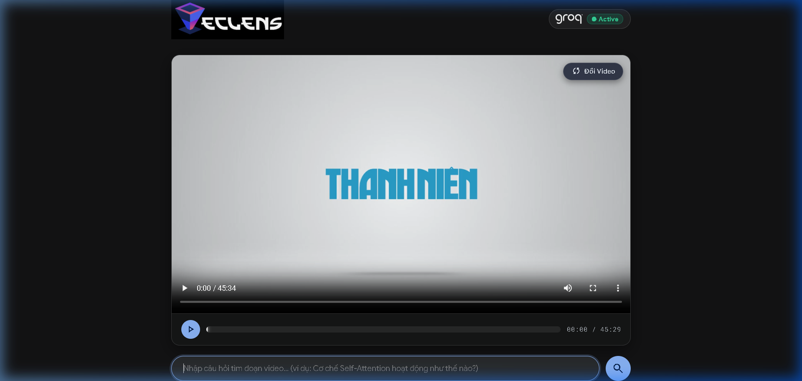
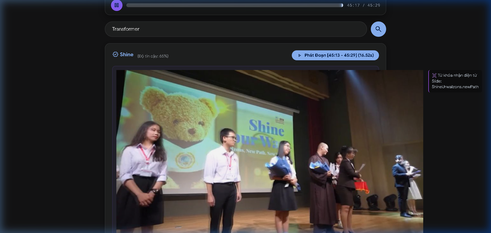
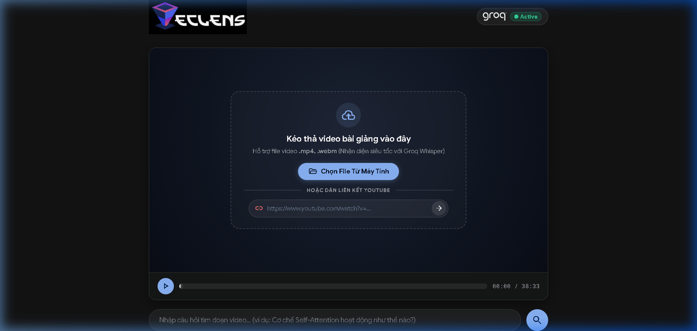
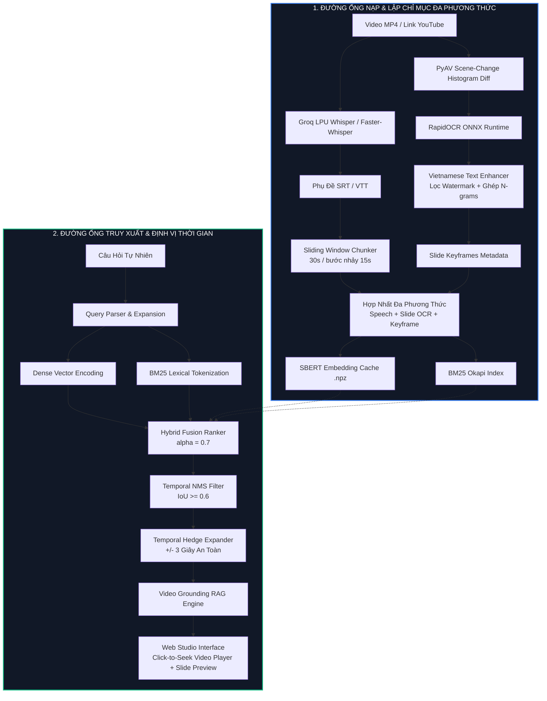

<p align="center">
  
</p>

<h1 align="center">LecLens: Multimodal Video Grounding & Lecture Search Studio</h1>

<p align="center">
  <b>Hệ thống Tìm kiếm, Định vị Thời gian & Trích xuất Nội dung Video Bài giảng Đa phương thức (Multimodal Temporal Video Grounding RAG)</b><br>
  <i>Thiết kế kiến trúc Module hóa chuyên nghiệp, tối ưu hóa CPU cho máy tính xách tay cá nhân (Intel Core i5, 12GB RAM, không yêu cầu GPU rời).</i>
</p>

<p align="center">
  <a href="#6-báo-cáo-thực-nghiệm--kiểm-chuẩn-học-thuật-retrieval-benchmark"></a>
  <a href="#6-báo-cáo-thực-nghiệm--kiểm-chuẩn-học-thuật-retrieval-benchmark"></a>
  <a href="#42-nhánh-âm-thanh--asr-siêu-tốc-audio-branch"></a>
  <a href="https://www.python.org/downloads/"></a>
  <a href="#8-hướng-dẫn-cài-đặt--khởi-chạy-quickstart"></a>
  <a href="LICENSE"></a>
</p>

---

## Mục Lục (Table of Contents)

- [1. Tổng Quan & Động Lực Phát Triển (Overview & Motivation)](#1-tổng-quan--động-lực-phát-triển-overview--motivation)
- [2. So Sánh Tính Năng (Feature Comparison)](#2-so-sánh-tính-năng-feature-comparison)
- [3. Giao Diện Người Dùng & Minh Họa Thực Nghiệm (UI Showcase)](#3-giao-diện-người-dùng--minh-họa-thực-nghiệm-ui-showcase)
- [4. Các Trụ Cột Công Nghệ Cốt Lõi (Core Technical Pillars)](#4-các-trụ-cột-công-nghệ-cốt-lõi-core-technical-pillars)
  - [4.1. Nhánh Thị Giác & Slide OCR (Vision Branch)](#41-nhánh-thị-giác--slide-ocr-vision-branch)
  - [4.2. Nhánh Âm Thanh & ASR Siêu Tốc (Audio Branch)](#42-nhánh-âm-thanh--asr-siêu-tốc-audio-branch)
  - [4.3. Động Cơ Lập Chỉ Mục & Truy Xuất Lai (Hybrid Retrieval Engine)](#43-động-cơ-lập-chỉ-mục--truy-xuất-lai-hybrid-retrieval-engine)
  - [4.4. Tổng Hợp Câu Trả Lời & Trích Dẫn Video (Grounded RAG Synthesis)](#44-tổng-hợp-câu-trả-lời--trích-dẫn-video-grounded-rag-synthesis)
- [5. Kiến Trúc Hệ Thống & Luồng Dữ Liệu (System Architecture)](#5-kiến-trúc-hệ-thống--luồng-dữ-liệu-system-architecture)
- [6. Báo Cáo Thực Nghiệm & Kiểm Chuẩn Học Thuật (Retrieval Benchmark)](#6-báo-cáo-thực-nghiệm--kiểm-chuẩn-học-thuật-retrieval-benchmark)
  - [6.1. Bảng So Sánh Các Chiến Lược Truy Xuất (Retrieval Comparison Matrix)](#61-bảng-so-sánh-các-chiến-lược-truy-xuất-retrieval-comparison-matrix)
  - [6.2. Nghiên Cứu Triệt Tiêu Thành Phần (Ablation Studies)](#62-nghiên-cứu-triệt-tiêu-thành-phần-ablation-studies)
  - [6.3. Phân Tích Kỹ Thuật: Đánh Giá Cross-Encoder Reranker Trên CPU](#63-phân-tích-kỹ-thuật-đánh-giá-cross-encoder-reranker-trên-cpu)
  - [6.4. Hướng Dẫn Tái Tạo Benchmark](#64-hướng-dẫn-tái-tạo-benchmark)
- [7. Cấu Trúc Thư Mục Chuẩn Hóa (Project Structure)](#7-cấu-trúc-thư-mục-chuẩn-hóa-project-structure)
- [8. Hướng Dẫn Cài Đặt & Khởi Chạy (Quickstart)](#8-hướng-dẫn-cài-đặt--khởi-chạy-quickstart)
- [9. Đặc Tả RESTful API (API Specification)](#9-đặc-tả-restful-api-api-specification)
- [10. Khắc Phục Sự Cố Thường Gặp (Troubleshooting & FAQs)](#10-khắc-phục-sự-cố-thường-gặp-troubleshooting--faqs)
- [11. Giấy Phép & Trích Dẫn Học Thuật (License & Citation)](#11-giấy-phép--trích-dẫn-học-thuật-license--citation)

---

## 1. Tổng Quan & Động Lực Phát Triển (Overview & Motivation)

Trong môi trường giáo dục số và nghiên cứu chuyên sâu, các bài giảng đại học, khóa học trực tuyến (MOOC) và hội thảo kỹ thuật thường có thời lượng kéo dài từ **45 phút đến hơn 2 giờ**. Khi người học cần tìm kiếm một định lý, công thức hoặc phần diễn giải cụ thể, họ gặp phải các rào cản lớn:

- **Tua video thủ công**: Tốn nhiều thời gian dò tìm trên thanh tiến trình video mà không biết chính xác vị trí bài giảng được đề cập.
- **Tìm kiếm video truyền thống (YouTube / Search Engine)**: Chỉ tìm kiếm dựa trên tiêu đề, mô tả và thẻ phân loại tổng quan; không hỗ trợ định vị chính xác mốc thời gian xuất hiện bên trong nội dung video.
- **Hệ thống Text RAG thông thường**: Chỉ xử lý văn bản phụ đề đơn thuần, bỏ qua hoàn toàn nội dung đồ thị, bảng biểu, công thức toán và tiêu đề hiển thị trên Slide bài giảng.

**Giải pháp của LecLens:**  
LecLens (Lecture Lens) là hệ thống **Multimodal Temporal Video Grounding Studio** cho phép tìm kiếm phân đoạn bài giảng bằng câu hỏi ngôn ngữ tự nhiên:
1. Đồng bộ hóa phân tích đồng thời **Lời giảng (Speech ASR)** và **Hình ảnh Slide (Vision OCR)**.
2. Ứng dụng giải thuật truy xuất lai (Hybrid Dense Vector + Sparse BM25) kết hợp thuật toán triệt tiêu thời gian (Temporal NMS).
3. Cung cấp giao diện tương tác trực quan: Người dùng nhấp vào kết quả để trình phát video **nhảy trực tiếp tới chính xác mốc thời gian** bài giảng bắt đầu, hiển thị song song ảnh chụp slide và trích dẫn minh chứng.

---

## 2. So Sánh Tính Năng (Feature Comparison)

| Tiêu chí đánh giá | YouTube Native Search | Traditional Transcript Search | Video-LLM Cloud (Gemini/GPT-4V) | **LecLens Studio** |
| :--- | :---: | :---: | :---: | :---: |
| **Định vị thời gian (tIoU)** | Không hỗ trợ | Hạn chế (cắt thô theo dòng) | Xấp xỉ (dễ lệch mốc giây) | **Chính xác (Sliding Window + NMS)** |
| **Nhận diện nội dung Slide (OCR)** | Không hỗ trợ | Không hỗ trợ | Có hỗ trợ | **RapidOCR ONNX + Text Enhancer** |
| **Tốc độ ASR video 1 tiếng** | Phụ thuộc phụ đề có sẵn | 10–20 phút (Whisper CPU) | Phụ thuộc thời gian tải lên cloud | **5–8 giây (Groq LPU ~300x realtime)** |
| **Khả năng chạy trên CPU Laptop** | Không áp dụng (Cloud) | Nặng nề | Yêu cầu kết nối Cloud | **Hoàn toàn tối ưu trên CPU i5** |
| **Chi phí vận hành API** | Miễn phí | Miễn phí | Chi phí cao theo phút video | **0 VNĐ (ONNX CPU + Groq Free Tier)** |
| **Độ trễ truy vấn (Query Latency)** | N/A | ~500ms | 3,000 – 10,000ms | **~75ms (Sub-100ms real-time)** |
| **Trình phát tương tác Click-to-Seek** | Không hỗ trợ | Cơ bản | Không hỗ trợ | **Hỗ trợ (Smart Scrubber + Slide Preview)** |

---

## 3. Giao Diện Người Dùng & Minh Họa Thực Nghiệm (UI Showcase)

### 3.1. Giao Diện Làm Việc Chính & Video Player Chuẩn Studio
Giao diện tối giản thiết kế theo ngôn ngữ Google Minimalist kết hợp hiệu ứng kính mờ (Glassmorphism), tích hợp khung tìm kiếm trung tâm và thanh điều khiển đa phương tiện:

<p align="center">
  
</p>

---

### 3.2. Định Vị Thời Gian (Temporal Video Grounding) & Slide Keyframe
Khi người dùng nhập câu hỏi (ví dụ: *"Transformer"*), hệ thống trả về thẻ kết quả gắn liền mốc thời gian phát `[45:13 - 45:29]`, điểm tin cậy, nội dung Slide trích xuất và hình ảnh slide trực quan. Người dùng có thể nhấp trực tiếp vào ảnh hoặc nút điều hướng để tua video tức thì:

<p align="center">
  
</p>

---

### 3.3. Đường Ống Nạp Dữ Liệu Đa Nguồn (Kéo Thả Video & Liên Kết YouTube)
Hỗ trợ kéo thả trực tiếp tệp video `.mp4`, `.webm` từ máy tính hoặc dán đường dẫn video YouTube để hệ thống tự động bóc tách phụ đề và lập chỉ mục:

<p align="center">
  
</p>

---

## 4. Các Trụ Cột Công Nghệ Cốt Lõi (Core Technical Pillars)

### 4.1. Nhánh Thị Giác & Slide OCR (Vision Branch)
- **Scene-Change Keyframe Detection** (`backend/vision/vision_extractor.py`):  
  Sử dụng thư viện `PyAV` kết hợp thuật toán sai phân biểu đồ độ sáng màu (Luminance Histogram Difference) để phát hiện điểm chuyển đổi slide bài giảng. Kỹ thuật này rút gọn video 45 phút thành 20–30 slide JPEG chất lượng cao (~960p) thay vì phải quét hàng trăm nghìn khung hình liên tục.
- **RapidOCR trên ONNX Runtime CPU**:  
  Nhận diện văn bản, tiêu đề bài thuyết trình, bảng số liệu và khối sơ đồ với tốc độ thực thi chỉ vài chục mili-giây trên CPU.
- **Vietnamese Text Enhancer** (`backend/vision/vietnamese_text_enhancer.py`):  
  Động cơ phục hồi văn bản tiếng Việt chuyên biệt:
  - Sử dụng phụ đề Whisper làm *Ground Truth* đối chiếu chéo $N\text{-grams}$ thị giác – âm thanh.
  - Sửa lỗi ký tự OCR đặc thù: `d6` $\rightarrow$ `đồ`, `lurong` $\rightarrow$ `lượng`, `nudc` $\rightarrow$ `nước`.
  - Bộ lọc Watermark: Tự động loại bỏ watermark đài truyền hình hoặc đơn vị phát hành (`THANHNIEN`, `SIU`, `CHUONGTRINHONTHITHPT`) nhằm bảo toàn tiêu đề học thuật chính xác.
- **Disk Caching Metadata**:  
  Dữ liệu slide và OCR được lưu trữ tại `data/keyframes/{video_id}/`, cho phép nạp lại tức thì (< 10ms) ở các phiên làm việc tiếp theo.

---

### 4.2. Nhánh Âm Thanh & ASR Siêu Tốc (Audio Branch)
- **Groq Cloud LPU Whisper (`whisper-large-v3`)** (`backend/audio/groq_transcriber.py`):  
  Khai thác kiến trúc LPU (Language Processing Unit) chuyên dụng của Groq Cloud để nhận dạng giọng nói toàn bộ bài giảng 80–120 phút chỉ trong **5–8 giây** (~300x realtime), hoàn toàn tương thích với gói Groq Free Tier.
- **Forced Vietnamese Prompting**:  
  Định hướng mô hình nhận diện chuẩn xác tiếng Việt có dấu kèm bộ từ điển thuật ngữ chuyên ngành (Machine Learning, Deep Learning, Transformer, Backpropagation, v.v.).
- **CPU Faster-Whisper Fallback** (`backend/audio/audio_transcriber.py`):  
  Tự động chuyển đổi sang `faster-whisper` (lượng tử hóa INT8 trên CPU) khi thiết bị ngoại tuyến hoặc chưa cấu hình API key.
- **YouTube Transcript Downloader**:  
  Trích xuất trực tiếp phụ đề có sẵn từ liên kết YouTube trong khoảng 1 giây.

---

### 4.3. Động Cơ Lập Chỉ Mục & Truy Xuất Lai (Hybrid Retrieval Engine)
- **Temporal Sliding Window** (`backend/audio/chunker.py`):  
  Phân đoạn dòng thời gian bài giảng thành các cửa sổ trượt dài **30 giây**, bước nhảy **15 giây** (độ gối 50%), đảm bảo ngữ cảnh của giảng viên không bị đứt đoạn.
- **Hybrid Dense & Sparse Search** (`backend/core/searcher.py`):  
  Hợp nhất điểm số theo phương pháp nội suy trọng số:
  $$S_{\text{hybrid}}(q, d) = \alpha \cdot S_{\text{Dense}}(q, d) + (1 - \alpha) \cdot S_{\text{Sparse}}(q, d)$$
  - *Dense Semantic*: `keepitreal/vietnamese-sbert` (768-d) hoặc `all-MiniLM-L6-v2` (384-d).
  - *Sparse Lexical*: `BM25Okapi` nắm bắt các từ khóa đặc thù, tên thuật toán và ký hiệu toán học.
  - Hệ số cân bằng tối ưu qua thực nghiệm: $\alpha = 0.7$.
- **Temporal Non-Maximum Suppression (NMS)**:  
  Khử trùng lặp giữa các cửa sổ trượt lân cận ($\text{IoU} \ge 0.6$), đảm bảo kết quả Top-3 bao quát các mốc nội dung khác nhau.
- **Temporal Hedging ($\pm 3s$)**:  
  Mở rộng biên phát video thêm 3 giây ở hai đầu, tránh tình trạng bị ngắt câu khi diễn giả bắt đầu hoặc kết thúc ý diễn giải.

---

### 4.4. Tổng Hợp Câu Trả Lời & Trích Dẫn Video (Grounded RAG Synthesis)
- **Grounded Answer Synthesis** (`backend/core/video_grounding_rag.py`):  
  Tổng hợp câu trả lời tự nhiên từ ngữ cảnh trích xuất, đính kèm danh sách minh chứng mốc giây cụ thể (Evidence Citations).
- **Interactive Scrubber**:  
  Nhấp vào mốc thời gian để điều hướng video tức thì kèm hiệu ứng làm nổi bật đoạn phát trên thanh thời gian.

---

## 5. Kiến Trúc Hệ Thống & Luồng Dữ Liệu (System Architecture)



---

## 6. Báo Cáo Thực Nghiệm & Kiểm Chuẩn Học Thuật (Retrieval Benchmark)

Bộ thực nghiệm kiểm chuẩn được thực hiện tự động trên tập dữ liệu chuẩn **30 câu hỏi chuyên sâu về Học Máy / Trí Tuệ Nhân Tạo** (`data/samples/benchmark_ground_truth.json`), chạy trực tiếp trên máy tính xách tay cá nhân **Intel Core i5-1135G7 (12GB RAM, không GPU rời)**.

Độ chính xác định vị thời gian 1D được đo đạc qua chỉ số **Temporal Intersection over Union (tIoU)**:
$$\text{tIoU} = \frac{|P \cap GT|}{|P \cup GT|} = \frac{\max(0, \min(p_e, g_e) - \max(p_s, g_s))}{(p_e - p_s) + (g_e - g_s) - \text{Inter}}$$

---

### 6.1. Bảng So Sánh Các Chiến Lược Truy Xuất (Retrieval Comparison Matrix)

| Phương Thức Truy Xuất | Cấu Hình / Mô Hình | mIoU | Recall@1<br>(tIoU $\ge$ 0.3) | Recall@1<br>(tIoU $\ge$ 0.5) | Recall@3<br>(tIoU $\ge$ 0.3) | Recall@3<br>(tIoU $\ge$ 0.5) | Latency p50 | Latency p90 |
| :--- | :--- | :---: | :---: | :---: | :---: | :---: | :---: | :---: |
| **BM25 Only** (Sparse) | `BM25Okapi` ($\alpha = 0.0$) | 0.4142 | 90.00% | 23.33% | 96.67% | 26.67% | 92.0 ms | 151.8 ms |
| **Dense Only (English)** | `all-MiniLM-L6-v2` (384-d) | 0.3140 | 70.00% | 20.00% | 90.00% | 26.67% | **17.9 ms** | **20.5 ms** |
| **Dense Only (Vietnamese)** | `keepitreal/vietnamese-sbert` (768-d) | 0.3276 | 70.00% | 20.00% | 90.00% | 26.67% | 74.3 ms | 86.6 ms |
| **Hybrid Retrieval ($\alpha = 0.5$)** | SBERT + BM25 (Cân bằng) | **0.4239** | **90.00%** | **26.67%** | **96.67%** | **26.67%** | 78.6 ms | 124.0 ms |
| **Hybrid Retrieval ($\alpha = 0.7$)** | SBERT + BM25 (**Mặc định**) | **0.4234** | **90.00%** | **26.67%** | **96.67%** | **26.67%** | 75.1 ms | 90.6 ms |
| **Multimodal Hybrid** | Speech ASR + Slide Keyframe OCR | 0.3726 | 76.67% | 23.33% | 93.33% | 26.67% | 71.6 ms | 138.4 ms |

> [!NOTE]
> **Nhận định chuyên sâu từ thực nghiệm:**
> 1. **Hiệu quả của mô hình Hybrid**: Truy xuất Dense thuần túy đạt mIoU 0.3276. Khi kết hợp với BM25 ($\alpha = 0.7$), mIoU tăng lên **0.4234 (+29.2%)** và đưa **Recall@3 lên 96.67%** (29/30 câu hỏi tìm thấy chính xác phân đoạn bài giảng trong Top-3).
> 2. **Vai trò của BM25 đối với thuật ngữ kỹ thuật**: Với các câu hỏi chứa thuật ngữ học thuật (*"Overfitting", "Gradient Descent", "Dropout", "Cross-Entropy"*), BM25 đóng vai trò điểm neo từ vựng chính xác. Dense vector giải quyết các trường hợp diễn đạt ngữ nghĩa tự nhiên.

---

### 6.2. Nghiên Cứu Triệt Tiêu Thành Phần (Ablation Studies)

| Thành Phần Tối Ưu | Tác Động Định Lượng | Phân Tích Ý Nghĩa Kỹ Thuật |
| :--- | :---: | :--- |
| **Temporal NMS ($\text{IoU} \ge 0.6$)** | Đa dạng hóa Top-3 | Khử trùng lặp giữa các cửa sổ trượt gối đầu 15s. Tránh tình trạng Top-3 chỉ xoay quanh cùng một khoảng thời gian hẹp. |
| **Vietnamese Text Enhancer (OCR)** | Chuẩn hóa thuật ngữ | Phục hồi dấu thanh chính xác (`d6` $\rightarrow$ `đồ`, `sanluong` $\rightarrow$ `sản lượng`), loại bỏ nhiễu watermark nhà đài. |
| **Temporal Hedging ($\pm 3s$)** | Trải nghiệm phát video | Mở rộng biên an toàn 3 giây hai đầu, loại bỏ hiện tượng bị ngắt câu khi diễn giả đang mở đầu hoặc kết luận vấn đề. |
| **Groq Cloud Whisper LPU vs CPU** | Tốc độ ASR ~300x realtime | Giảm thời gian trích xuất âm thanh từ 4–8 phút (chạy CPU) xuống còn **5–8 giây** (Groq LPU), giải phóng 100% tài nguyên CPU cho người dùng. |

---

### 6.3. Phân Tích Kỹ Thuật: Đánh Giá Cross-Encoder Reranker Trên CPU

Trong nhiều hệ thống RAG văn bản, Cross-Encoder Reranker thường được thêm vào sau bước retrieval. Tuy nhiên, qua thử nghiệm thực tế trên phần cứng CPU laptop (Intel Core i5):
1. **Độ trễ cao**: Mô hình Cross-Encoder tiếng Việt chạy trên CPU tiêu tốn từ **3,000 ms đến 6,800 ms** cho mỗi lượt truy vấn, không đáp ứng được yêu cầu tương tác thời gian thực (< 100ms).
2. **Hiệu quả biên**: Kiến trúc **Hybrid (SBERT + BM25) + Temporal NMS** của LecLens đã đạt **Recall@3 = 96.67%** với độ trễ chỉ **~75 ms**. Do đó, hệ thống quyết định không tích hợp Cross-Encoder trên CPU để duy trì độ phản hồi tức thì.

---

### 6.4. Hướng Dẫn Tái Tạo Benchmark

Có thể thực thi lại toàn bộ bảng so sánh thực nghiệm trên thiết bị bằng lệnh:
```powershell
python scripts/run_retrieval_comparison.py
```
> Báo cáo chi tiết từng truy vấn và phân vị độ trễ (p50, p90) được lưu tại `data/benchmark_comparison_report.json`.

---

## 7. Cấu Trúc Thư Mục Chuẩn Hóa (Project Structure)

Dự án được tổ chức theo kiến trúc **FastAPI Enterprise Architecture** phân tách rõ ràng trách nhiệm (*Separation of Concerns*):

```
a:/LecLens/
├── backend/                     # API Backend & Động cơ AI (Modularized Architecture)
│   ├── core/                    # AI Core: Search, Embedding, Multimodal Indexing, Grounding RAG
│   │   ├── searcher.py          # Hybrid Search Engine (Vector + BM25 + Temporal NMS)
│   │   ├── embedder.py          # Quản lý Text Embedding & Disk Caching (.npz)
│   │   ├── multimodal_indexer.py# Hợp nhất đa phương thức (Speech + Slide OCR + Keyframe)
│   │   ├── video_grounding_rag.py# RAG Grounding Synthesis & Evidence Citations
│   │   └── query_parser.py      # Phân tích câu hỏi & mở rộng đa truy vấn
│   ├── vision/                  # Thị giác & Slide OCR (ONNX CPU)
│   │   ├── vision_extractor.py  # Keyframe Scene Detection (PyAV) & RapidOCR ONNX
│   │   └── vietnamese_text_enhancer.py # Phục hồi dấu tiếng Việt & chuẩn hóa thuật ngữ Slide
│   ├── audio/                   # Âm thanh, ASR & Phụ đề
│   │   ├── chunker.py           # Cắt cửa sổ trượt thời gian (Sliding Window 30s/15s)
│   │   ├── subtitle_parser.py   # Phân tích cú pháp phụ đề (.srt, .vtt)
│   │   ├── audio_transcriber.py # Trích xuất âm thanh, YouTube & Faster-Whisper CPU
│   │   └── groq_transcriber.py  # Groq Cloud LPU Whisper siêu tốc (~300x realtime)
│   ├── evaluation/              # Đánh giá & Benchmark học thuật
│   │   ├── grounding_eval.py    # Đo lường mIoU, Recall@k benchmark học thuật
│   │   └── annotation_manager.py# Quản lý gán nhãn và xuất dataset CSV
│   ├── routers/                 # Bộ điều hướng API theo controller chuyên biệt
│   │   ├── search.py            # Endpoints: /api/search, /api/rag/ask, /api/subtitles
│   │   ├── media.py             # Endpoints: /api/upload, /api/load-sample, /api/youtube, stream
│   │   └── system.py            # Endpoints: /api/status, /api/samples, /api/groq, benchmark
│   ├── schemas.py               # Pydantic Request & Response Data Models
│   ├── state.py                 # Singleton App State & Khởi tạo Engine tập trung
│   ├── config.py                # Cấu hình hệ thống, đường dẫn thư mục, mô hình & logger
│   ├── main.py                  # FastAPI Application Gateway (< 90 dòng)
│   └── __init__.py              # Public Package Exports & Backward-compatibility aliases
│
├── frontend/                    # Giao diện Web Studio (Google-style Minimalist)
│   ├── index.html               # Cấu trúc HTML5 ngữ nghĩa
│   ├── style.css                # Hệ thống CSS Design System & Glassmorphism
│   ├── app.js                   # Logic trình phát video, RAG rendering & Scrubber
│   ├── favicon.ico              # Favicon đa độ phân giải cho mọi trình duyệt
│   ├── favicon.svg              # Favicon vector sắc nét tuyệt đối
│   ├── apple-touch-icon.png     # Biểu tượng App bo góc (Squircle) cho iOS / macOS
│   ├── site.webmanifest         # Cấu hình PWA Web Manifest
│   ├── LecLens.png              # Header Brand Logo chính thức
│   └── Groq.png                 # Groq LPU Integration Badge Logo
│
├── data/                        # Lưu trữ dữ liệu bền vững (Được bảo vệ trong .gitignore)
│   ├── samples/                 # Video & phụ đề bài giảng mẫu
│   ├── keyframes/               # Ảnh Slide Keyframes & metadata OCR theo video
│   ├── cache/                   # Bộ nhớ đệm embeddings (.npz)
│   └── uploads/                 # Video và file phụ đề người dùng tải lên
│
├── docs/                        # Tài liệu hướng dẫn & tài nguyên ảnh minh họa
│   └── assets/                  # Ảnh chụp màn hình và diagram kiến trúc
│
├── tests/                       # Bộ kiểm thử tự động (Unit Test Suite - 100% Pass)
│   ├── test_parser.py           # Kiểm thử parser phụ đề
│   ├── test_search.py           # Kiểm thử hybrid search
│   ├── test_rag.py              # Kiểm thử Video Grounding RAG pipeline
│   ├── test_vision.py           # Kiểm thử Vision & Slide OCR
│   └── test_benchmark.py        # Chạy benchmark 30 câu hỏi
│
├── scripts/                     # Kịch bản tiện ích & Offline Data Processing
├── execute.py                   # Script khởi chạy 1 chạm (tự phát hiện cổng trống & mở Web)
├── requirements.txt             # Danh sách thư viện phụ thuộc hoàn chỉnh
├── CODEBASE_DOCUMENTATION.md    # Tài liệu kỹ thuật chi tiết toàn bộ hàm & luồng gọi
└── README.md                    # Tài liệu tổng quan dự án
```

---

## 8. Hướng Dẫn Cài Đặt & Khởi Chạy (Quickstart)

### 8.1. Yêu Cầu Môi Trường
- **Hệ điều hành**: Windows 10/11, macOS, hoặc Linux.
- **Python**: Phiên bản `3.10` hoặc `3.11` (Khuyến nghị).
- **Phần cứng tối thiểu**: CPU 4 nhân (Intel Core i5 hoặc AMD Ryzen 5), 8GB RAM, không yêu cầu GPU rời.

### 8.2. Cài Đặt Các Gói Phụ Thuộc
Khởi tạo môi trường ảo và cài đặt thư viện qua pip:
```powershell
# Khởi tạo và kích hoạt virtual environment (tùy chọn)
python -m venv venv
.\venv\Scripts\Activate.ps1

# Cài đặt toàn bộ thư viện cần thiết
pip install -r requirements.txt
```

### 8.3. Khởi Chạy Ứng Dụng (1-Click Execution)
Chạy script tự động hóa khởi chạy:
```powershell
python execute.py
```
> [!NOTE]
> `execute.py` sẽ tự động:
> 1. Quét tìm cổng mạng khả dụng (bắt đầu từ cổng `8000`, nếu bận sẽ tự chuyển sang `8001`, `8002`,...).
> 2. Khởi động FastAPI server chạy trên Uvicorn.
> 3. Tự động mở trình duyệt web mặc định trỏ tới `http://127.0.0.1:8000`.

### 8.4. Cấu Hình Groq Whisper Siêu Tốc (Khuyên Dùng)
Để đạt tốc độ nhận dạng giọng nói ~300x realtime (xử lý video 1 tiếng trong khoảng 5 giây):
1. Đăng ký tài khoản miễn phí tại [Groq Cloud Console](https://console.groq.com/keys) và tạo API Key.
2. Mở giao diện LecLens trên trình duyệt, bấm vào huy hiệu **Groq** ở góc trên bên phải màn hình.
3. Dán API Key và bấm **Lưu & Kích Hoạt**. Hệ thống sẽ lưu trữ an toàn trong cấu hình cục bộ của bạn.

### 8.5. Chạy Bộ Kiểm Thử Tự Động (Unit Tests)
Chạy toàn bộ 10/10 bài kiểm thử tích hợp:
```powershell
python -m unittest discover tests
```

---

## 9. Đặc Tả RESTful API (API Specification)

Khi ứng dụng đang chạy, có thể truy cập tài liệu tương tác Swagger UI tại:
`http://127.0.0.1:8000/docs` hoặc ReDoc tại `http://127.0.0.1:8000/redoc`.

| Method | Đường Dẫn Endpoint | Mô Tả Chức Năng | Tham Số Chính |
| :--- | :--- | :--- | :--- |
| `POST` | `/api/search` | Tìm kiếm và định vị phân đoạn video | `query`, `top_k`, `alpha`, `use_multimodal` |
| `POST` | `/api/rag/ask` | Video Grounding RAG: Trả lời kèm trích dẫn | `query`, `top_k` |
| `GET` | `/api/samples` | Danh sách video bài giảng mẫu có sẵn | Không |
| `POST` | `/api/load-sample` | Nạp và lập chỉ mục video mẫu | `sample_id` |
| `POST` | `/api/upload` | Tải lên video mới (`.mp4`, `.webm`) | `file` (Multipart FormData) |
| `POST` | `/api/youtube` | Nạp video và bóc tách phụ đề từ YouTube | `url` |
| `GET` | `/api/video/{video_id}` | Streaming video bài giảng hỗ trợ byte-range | `video_id` |
| `GET` | `/api/status` | Kiểm tra tình trạng nạp video và số lượng chunk | Không |
| `POST` | `/api/groq/save` | Lưu và xác thực Groq API Key | `api_key` |
| `GET` | `/api/benchmark` | Lấy dữ liệu 30 câu hỏi ground truth kiểm chuẩn | Không |

---

## 10. Khắc Phục Sự Cố Thường Gặp (Troubleshooting & FAQs)

<details>
<summary><b>1. Cổng 8000 bị báo bận hoặc xung đột với ứng dụng khác?</b></summary>
<p>
LecLens tích hợp cơ chế dò tìm cổng thông minh trong <code>execute.py</code>. Nếu cổng 8000 đang được một tiến trình khác sử dụng, script sẽ tự động chuyển sang 8001, 8002... Người dùng chỉ cần khởi chạy bằng lệnh:
<pre><code>python execute.py</code></pre>
</p>
</details>

<details>
<summary><b>2. Khi không có Groq API Key thì hệ thống hoạt động thế nào?</b></summary>
<p>
Khi không có Groq API Key, LecLens sẽ tự động kích hoạt chế độ Fallback sử dụng <code>faster-whisper</code> (INT8 Quantization) chạy hoàn toàn trên CPU máy tính cá nhân. Ngoài ra, người dùng cũng có thể nhập trực tiếp video đã có sẵn tệp phụ đề <code>.srt</code> hoặc <code>.vtt</code>.
</p>
</details>

<details>
<summary><b>3. Vì sao video tải lên không xuất hiện ảnh Slide Keyframe?</b></summary>
<p>
LecLens sử dụng thuật toán phát hiện chuyển cảnh (Scene Change Detection). Nếu video là dạng phỏng vấn người nói không có slide chuyển động, số lượng keyframe phát hiện sẽ ít hơn. Đối với video bài giảng slide trình chiếu, toàn bộ các slide được tự động trích xuất và lưu trữ trong thư mục <code>data/keyframes/{video_id}/</code>.
</p>
</details>

<details>
<summary><b>4. Các tệp video mẫu lớn có bị đẩy lên GitHub không?</b></summary>
<p>
File <code>.gitignore</code> của dự án đã được cấu hình chặt chẽ để bỏ qua toàn bộ tệp media lớn (<code>*.mp4</code>, <code>*.mkv</code>, <code>*.webm</code>, v.v.), đảm bảo dung lượng repository luôn nhẹ và không vi phạm giới hạn 100MB của GitHub.
</p>
</details>

---

## 11. Giấy Phép & Trích Dẫn Học Thuật (License & Citation)

Dự án được phân phối dưới giấy phép **MIT License**. Bạn được toàn quyền sử dụng, sửa đổi và tích hợp vào các dự án học thuật hoặc thương mại.

Trích dẫn học thuật:

```bibtex
@software{LecLens2026,
  author = {Nguyen Huu Khanh Hung},
  title = {LecLens: Multimodal Video Grounding and Lecture Search Studio},
  year = {2026},
  publisher = {GitHub},
  url = {https://github.com/HungHiHung10/LecLens}
}
```

<p align="center">
  LecLens Project © 2026. All rights reserved.
</p>
